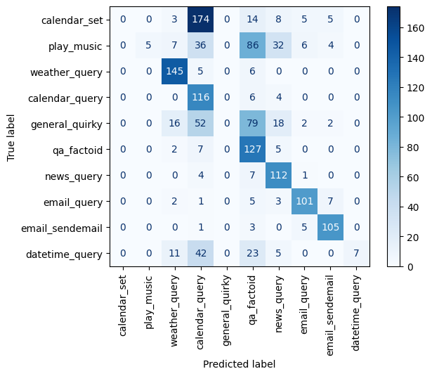

# Spanish Text Classification with LoRA and LLM-Generated Synthetic Data

Spanish intent classifier built with **BETO + LoRA** on a dataset with **imbalanced classes (20:1)**. The minority classes are augmented with **synthetic data generated by Qwen2.5-7B-Instruct**. With that data, test macro-F1 rises from **0.72 to 0.83** and the mean F1 of the minority classes from **0.60 to 0.81**.

> The notebook is written in Spanish. This README summarises the approach, the results and the main decisions.

## Results

| Model | Macro-F1 | Minority F1 | Accuracy |
| --- | --- | --- | --- |
| TF-IDF + Logistic Regression (baseline) | 0.442 | 0.051 | 0.505 |
| BETO + LoRA | 0.721 | 0.603 | 0.731 |
| **BETO + LoRA + synthetic data** | **0.834** | **0.809** | **0.831** |

Test F1 per minority class:

| Class | Baseline | LoRA | LoRA + synthetic |
| --- | --- | --- | --- |
| `calendar_set` | 0.00 | 0.64 | **0.82** |
| `play_music` | 0.06 | 0.84 | **0.93** |
| `general_quirky` | 0.00 | 0.13 | **0.56** |
| `datetime_query` | 0.15 | 0.80 | **0.93** |

Synthetic data improves all four minority classes, and the majority classes improve or stay level (the only drop is `email_query`, 0.91 → 0.90). The "sink" classes, which used to absorb minority errors, gain precision: `calendar_query` goes from 0.42 to 0.58 and `qa_factoid` from 0.61 to 0.72.

**Run-to-run variance.** The augmented experiment has been trained three times, each time with a different synthetic set. Macro-F1 was 0.816, 0.823 and 0.834, and `general_quirky` F1 ranged from 0.38 to 0.56. The LoRA run without synthetic data also moved between runs (macro-F1 0.681 and 0.721). Per-class scores therefore move by roughly ±0.05–0.1 between runs, while the overall gain (+0.11 macro-F1) is well above that noise.

## Problem and data

- **Dataset:** [MASSIVE, Spanish (`SetFit/amazon_massive_intent_es-ES`)](https://huggingface.co/datasets/SetFit/amazon_massive_intent_es-ES). These are utterances that users say to a voice assistant, labelled by intent.
- **Classes:** the 10 most frequent intents in the training set.
- **Controlled imbalance (train only):** 4 minority classes are chosen at random with a fixed seed (`play_music`, `calendar_set`, `general_quirky`, `datetime_query`) and kept at 20 examples each. Majority classes are capped at 400. The ratio is 20:1.
- **Validation and test are left untouched**, so the model is evaluated on the real data distribution rather than on the one created by downsampling.

| Split | Examples |
| --- | --- |
| Train (imbalanced) | 2,434 |
| Train + synthetic | 2,834 |
| Validation | 959 |
| Test | 1,422 |

## Approach

1. **Baseline:** TF-IDF (unigrams and bigrams, `sublinear_tf`) + logistic regression. It sets the floor to beat.
2. **BETO + LoRA:** parameter-efficient fine-tuning of `dccuchile/bert-base-spanish-wwm-cased` on the imbalanced training set.
3. **BETO + LoRA + synthetic data:** same setup, with 100 LLM-generated utterances added to each minority class.

Experiments 2 and 3 use exactly the same training function, hyperparameters and seed. Only the input dataset changes.

## Technical decisions

**Main metric: macro-F1.** It weights every class equally, regardless of how many examples it has. Accuracy and weighted-F1 weight by support, so they can hide a minority class that is missed entirely.

**Model: BETO.** It is pre-trained on Spanish text only, so its vocabulary and tokenizer are adapted to the language. For multilingual data, XLM-RoBERTa would be the alternative.

**LoRA (PEFT):**

| Parameter | Value |
| --- | --- |
| `r` / `lora_alpha` / `lora_dropout` | 8 / 16 / 0.1 |
| `target_modules` | `query`, `value` |
| Trainable parameters | 302,602 of 110 M (**0.27%**) |

Breakdown of trainable parameters: 12 layers × 2 modules × 2 matrices of 768×8 give 294,912 LoRA parameters, and the classification head (768×10 + 10) adds 7,690.

**Training:**
- `learning_rate`: 5e-4, higher than in full fine-tuning, as is usual with LoRA.
- `batch_size`: 64.
- `num_train_epochs`: 15. With 10 epochs, validation F1 was still rising.
- The best checkpoint is selected by validation macro-F1 (`load_best_model_at_end`). After a certain point, validation loss goes up while training loss keeps falling, which is a sign of overfitting.
- `max_length`: 32, chosen from the token-length distribution: the 95th percentile is 18, the 99th is 23 and the maximum is 35.

## Synthetic data generation

**Generator:** `Qwen/Qwen2.5-7B-Instruct`, quantised to 4 bits (NF4, `bitsandbytes`) so that it fits on a T4 GPU.

**Prompt.** Each call asks for 10 utterances and includes:
- A **class description** stating what the class is and what it is *not*. The exclusions are based on the confusions seen in the baseline confusion matrix.
- **5 real examples**, drawn at random from the training set on every call. Validation and test examples are never used, to avoid data leakage.
- Format constraints: one utterance per line, no numbering and no extra text.

Class descriptions (summarised from the Spanish prompts):

| Class | Description used in the prompt |
| --- | --- |
| `play_music` | Play songs, artists, genres, albums or playlists |
| `calendar_set` | Create events, reminders or alerts; not queries or deletions. Times and dates written out in words |
| `general_quirky` | Small talk with no concrete task: personal questions to the assistant, opinions, odd or philosophical questions. Not factual questions, greetings, jokes or information requests |
| `datetime_query` | Questions about the time, date or day, including other cities or time zones; not about calendar events |

**Cleaning:**
1. Strip bullets and numbering at the start of each line.
2. **Normalise to MASSIVE style**: lowercase, no punctuation, no quotes. If the synthetic data had a different style, the model could learn that style as a shortcut instead of the intent.
3. Keep only utterances made of letters and spaces.
4. Remove duplicates and exact copies of the real examples.
5. Downsample to **100 utterances per class**, so that all 4 classes get the same amount and the real examples keep their weight.

**Iterations on the generator:**
- **Qwen2.5-1.5B-Instruct:** in an informal review, only about 40% of the utterances were valid. Many were nonsensical ("enfrenta la tormenta con thriller") or literal translations from English ("jugar", Spanish for playing a game, used for *play* music). Discarded.
- **Qwen2.5-7B in 4 bits:** clearly better quality.
- **Numbers in words:** at first the character filter discarded almost every good `calendar_set` utterance, because they contained times in digits ("a las 10:30"). Asking for numbers written out in words fixed this, and it also matches the dataset style.
- **Exclusions for `general_quirky`:** with the first description, factual questions ("qué es la realidad virtual") leaked in, and those belong to `qa_factoid`. An explicit exclusion was added.
- **System prompt:** a string-concatenation bug meant the format instructions in the system message never reached the model. It was fixed for the final run.

**Quality (manual review of 5 utterances per class):** 19 of 20 valid. The only error is an utterance from another intent: "alguna canción nueva y bonita que me recomiendes", a music recommendation labelled as `general_quirky`. With a sample this small, the figure is only indicative.

## Error analysis

- **Baseline:** it never predicts `calendar_set` or `general_quirky`. Minority errors go to two "sink" classes:
  - **`calendar_query`**, because of semantic similarity. 174 of the 209 `calendar_set` utterances end up there ("set an appointment" vs. "what do I have tomorrow").
  - **`qa_factoid`**, a generic question class that even receives unrelated utterances, such as `play_music` ones. Here the cause is the lack of examples, not similarity between classes.
- **LoRA:** pre-training recovers `play_music` (F1 0.84) and `datetime_query` (0.80) from only 20 examples each. `calendar_set` is only partly recovered (0.64, recall 0.48) and `general_quirky` still fails (0.13, recall 0.07).
- **LoRA + synthetic:** `calendar_set` goes from 0.64 to 0.82. `general_quirky` rises from 0.13 to 0.56 but is still the weakest class (recall 0.41). It is the vaguest and most heterogeneous intent in MASSIVE, and also the noisiest in the synthetic data.

## Limitations and next steps

- **Volume vs. variety.** Part of the gain may come from simply having more minority examples rather than from the synthetic data itself. The next step is a **random oversampling** control: duplicating the 20 real examples up to 120.
- **Single seed per configuration.** Repeating with 3 seeds and reporting mean ± std would make the per-class figures more reliable (see the run-to-run variance above).
- **Synthetic data is not reproducible bit for bit.** LLM sampling is not seeded, so re-running the notebook produces a different synthetic set. `synthetic_data.csv` contains the exact data used for the reported results.
- **Noise in the synthetic data.** It could be filtered with an LLM-as-judge step or with embedding similarity to the real examples.
- **`general_quirky`** would need a sharper definition or more real examples.
- Compare BETO with XLM-RoBERTa for multilingual scenarios.

## How to run

1. Open `spanish_text_classification_lora.ipynb` in Google Colab.
2. Select *Runtime → Change runtime type → T4 GPU*.
3. Run all cells. Dependencies are installed in the first cell and listed in `requirements.txt`.

To skip generation, which takes a few minutes with the 7B model, load `synthetic_data.csv` instead.

## Files

| File | Contents |
| --- | --- |
| `spanish_text_classification_lora.ipynb` | Full notebook with outputs (in Spanish) |
| `synthetic_data.csv` | 400 synthetic utterances (100 per minority class) |
| `results.json` | Metrics of the three experiments |
| `cm_baseline.png` | Baseline confusion matrix |
| `requirements.txt` | Python dependencies |
